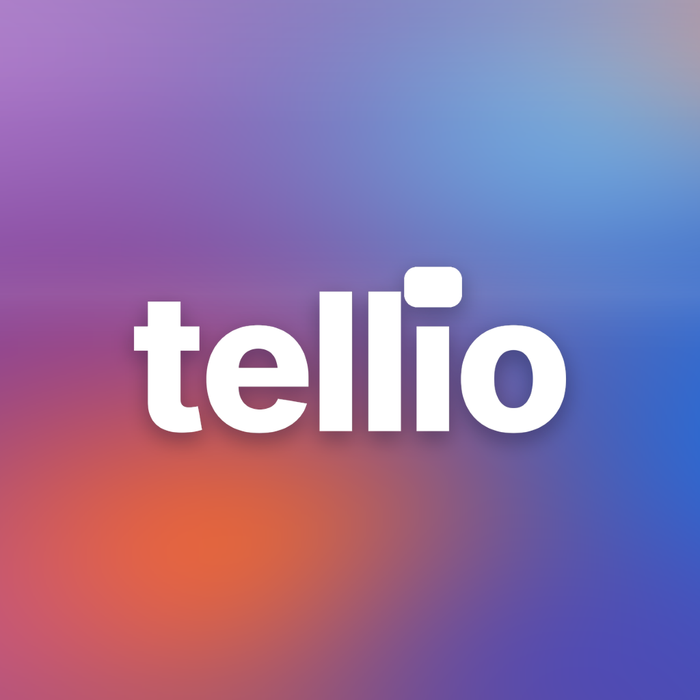

<p align="center">
  
</p>

<h1 align="center">Tellio for iPhone and iPad</h1>

<p align="center">
  A free player for your own addons and IPTV account, on iPhone and iPad.<br>
  <b>Beta</b> · iOS and iPadOS 26 or later · <a href="https://github.com/MS2620/tellio">Tellio for Apple TV</a> · <a href="https://github.com/MS2620/tellio-iOS/releases">Download</a>
</p>

Tellio plays what **you** bring: your IPTV provider's login for live TV, and your addons for films and series. On top of that it adds artwork, a proper TV guide, sports, Trakt sync and more. It's the iPhone and iPad version of [Tellio for Apple TV](https://github.com/MS2620/tellio) and shares its code, settings and backups.

> **Tellio doesn't include any channels, films or streams.** It only plays what your own IPTV account and addons provide. Use services you're entitled to.

## Features

- **Films and series:** trending, popular and new titles with seasons, episodes and cast. Streams come from your addons, filtered by quality.
- **Live TV with a real guide:**
  - A programme guide you can scroll through time and channels.
  - Favourites, your own folders and recent channels.
  - Search across every group.
  - Reminders that notify you before a programme starts.
- **Tellio's own player:**
  - Plays MKV, HEVC, surround sound and every subtitle format.
  - Picture in picture and AirPlay.
  - Swipe up or down to change channel.
  - Double-tap to skip, pinch to fill the screen.
- **Multiview:** two live channels at once on iPhone, four on iPad.
- **Sports:** your teams' fixtures, live scores, league tables and F1 standings. Tellio finds the channel showing the match in your guide.
- **Continue Watching:** pick up where you left off, with optional Trakt sync.
- **Parental PIN, appearances, and backup and restore.** A backup from the Apple TV restores on iPhone and iPad too, and the other way round.

## Install

Tellio isn't on the App Store. Each [release](https://github.com/MS2620/tellio-iOS/releases) has an unsigned **Tellio.ipa**. Install it with a sideloading tool that signs apps with your own Apple ID, such as [Sideloadly](https://sideloadly.io), [AltStore](https://altstore.io) or [SideStore](https://sidestore.io).

With a free Apple ID, sideloaded apps stop opening after 7 days until they're signed again; AltStore and SideStore can do this for you. A paid developer account lasts a year. Installing a newer build over the old one keeps your settings.

## Known limitations

- IPTV must use a provider login (server, username and password). M3U playlist links aren't supported yet.
- Only addon results with a direct link play; torrent-only results are hidden.
- Multiview opens one connection per channel. If your provider allows only one stream at a time, the extra channels won't play.
- Installing needs sideloading; there's no App Store or TestFlight version yet.
- Backup and restore needs a backup server you run yourself (see [`server/`](https://github.com/MS2620/tellio/tree/main/server) in the Apple TV repository).
- Tested with only a few providers and addons so far, so expect rough edges.

## Privacy

- Your logins, addons and watch history stay on your device, in its Keychain. There's no Tellio account.
- Crash reports go to Sentry. They contain no logins, stream links, server or channel names, IP address or watch history. Turn them off in **Settings › About**.
- Tellio asks TMDB, ESPN and Jolpica for film and sports information, and Trakt only if you sign in.

## Feedback and problems

[Open an issue](https://github.com/MS2620/tellio-iOS/issues/new) on GitHub. You need a GitHub account, and you can add screenshots.

Say what you did, what happened, and your build number (in Settings › About). Please don't post logins, server addresses or addon links.

## Building from source

Tellio for iPhone and iPad is a Swift package built with [xtool](https://github.com/xtool-org/xtool), so it builds on Linux (including WSL) as well as on a Mac. The shared Core and Services code comes from the Apple TV app through the `Vendor/tellio` submodule.

```bash
git clone --recurse-submodules https://github.com/MS2620/tellio-iOS.git
cd tellio-iOS
Scripts/run.sh            # build and install on a connected, unlocked iPhone or iPad
Scripts/package.sh release Tellio.ipa   # or just build an unsigned .ipa
```

You need xtool set up and signed in with your Apple ID (`xtool setup`). Use `Scripts/run.sh` rather than `xtool dev run`, because it also embeds the Sentry framework that xtool leaves out.

To pick up fixes from the Apple TV app, update the submodule: `git submodule update --remote Vendor/tellio`.

### Continuous builds

Every push to `master` is built by GitHub Actions ([`build.yml`](.github/workflows/build.yml)) and published as a pre-release with `Tellio.ipa` attached. Pull requests are built but not published.

The built-in keys come from repository secrets and are never in the code. A missing secret just leaves that feature for users to set up themselves:

| Secret | What it's for |
| --- | --- |
| `TMDB_TOKEN` | Film and series information without users adding their own TMDB key |
| `TRAKT_CLIENT_ID` | Trakt sign-in |
| `SENTRY_DSN` | Crash reports |
| `FEEDBACK_URL` | Send feedback from the app (filled in, but the iPhone app doesn't have the feedback page yet) |

## Licence

Tellio is **not open source**, but contributions are welcome. You can download the official builds and use them on your own devices, read the code, and fork it to fix bugs or add features and send them back as a pull request. You may not publish your own copies or versions of Tellio, or reuse its code elsewhere. The terms are the same as for the Apple TV app; see its [LICENSE](https://github.com/MS2620/tellio/blob/main/LICENSE).

## Third-party software

Tellio builds include these components, each under its own licence. Each build's release notes list the exact versions it includes.

- [AetherEngine](https://github.com/superuser404notfound/AetherEngine): LGPL-3.0 with an App Store exception. Tellio uses it unmodified.
- [FFmpegBuild](https://github.com/superuser404notfound/FFmpegBuild) (FFmpeg and related libraries), linked dynamically: LGPL; licence texts are in that repository's `LICENSES` folder.
- [libdovi](https://github.com/quietvoid/dovi_tool) (Dolby Vision metadata), Copyright (c) quietvoid and contributors: MIT.
- [Anime4K](https://github.com/bloc97/Anime4K) (line-art upscaling, inside AetherEngine), Copyright (c) 2019-2021 bloc97: MIT.
- [Sentry Cocoa SDK](https://github.com/getsentry/sentry-cocoa): MIT.

The full licence texts are in [`Resources/Licenses`](https://github.com/MS2620/tellio/tree/main/Resources/Licenses) in the Apple TV repository.
